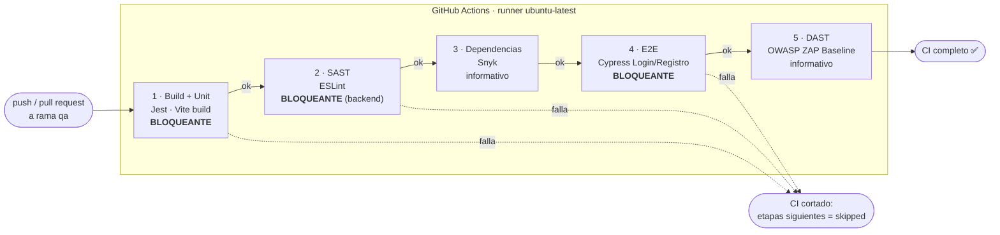
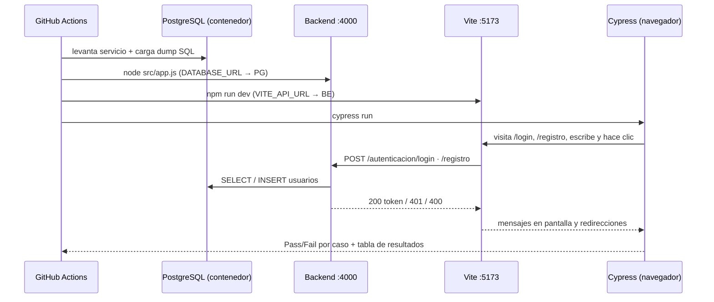

# Pruebas automatizadas y pipeline CI DevSecOps · Cuidarte+

**Asignatura:** ISY1102 Seguridad y Calidad del Software · **Responsable:** Diego Arias (DevSecOps y Automatización Funcional)
**Rama de trabajo:** `qa` · **Workflow:** `.github/workflows/quality-security.yml`
**Alcance:** solo **Integración Continua (CI)**. No hay despliegue continuo (CD): el pipeline verifica, no publica.

---

## 1. Diagrama del pipeline



**Regla fail-fast:** cada etapa declara `needs:` sobre la anterior. Si una etapa **bloqueante** falla, se cancela o supera su `timeout-minutes`, GitHub marca las siguientes como **skipped** y la ejecución queda en rojo: el CI no se completa.

---

## 2. Qué hace cada herramienta, cómo se levanta y cómo interactúan

| Etapa | Herramienta | ¿Para qué sirve? | ¿Cómo se levanta en el CI? | Tipo de control |
|---|---|---|---|---|
| — | **GitHub Actions** | Orquestador. Lee el YAML, crea una máquina virtual Ubuntu limpia por cada job y ejecuta los pasos en orden. | Se dispara solo con `push`/`pull_request` a `qa` (o manual con *Run workflow*). | Orquestación |
| 1 | **Jest** | Pruebas unitarias del backend: funciones aisladas (`normalizeRut`, esquemas de validación de login y registro). Detecta errores de lógica antes de levantar la app. | `npm install` en `BACKEND/` y `npm test` (`jest --runInBand`). | **Bloqueante** |
| 1 | **Vite build** | Compila el frontend React. Si el código no compila, no tiene sentido seguir. | `npm ci` + `npm run build` en `FRONTEND/`. | **Bloqueante** |
| 2 | **ESLint** (SAST) | Análisis estático: revisa el código fuente **sin ejecutarlo** buscando errores, variables no definidas y malas prácticas. | `npm run lint` en backend y frontend. | Backend **bloqueante**; frontend informativo (13 errores heredados del código base, registrados como deuda técnica) |
| 3 | **Snyk** (SCA) | Compara las librerías de `package.json` contra una base de vulnerabilidades conocidas (CVE). Revisa el código de terceros que usamos. | Se instala la CLI (`npm i -g snyk`) y se autentica con el secreto `SNYK_TOKEN` del repositorio. | Informativo (el sistema es intencionalmente vulnerable; el reporte queda en el log) |
| 4 | **PostgreSQL 15** | Base de datos efímera para las pruebas. | Contenedor `services: postgres` que GitHub levanta junto al job; se espera a `pg_isready` y se carga `BACKEND/sql/dump-cuidarteplus.sql` (esquema + datos semilla). | Infraestructura |
| 4 | **Backend Express** | API real que valida credenciales y registra usuarios. | `node src/app.js` en segundo plano, puerto **4000**, con `DATABASE_URL` al contenedor y un `JWT_SECRET` exclusivo de CI. `wait-on` espera a que responda. | Infraestructura |
| 4 | **Frontend Vite** | Interfaz que usa el usuario. | `npm run dev` en segundo plano, puerto **5173**, con `VITE_API_URL=http://localhost:4000`. `wait-on` espera a que responda. | Infraestructura |
| 4 | **Cypress** | Pruebas funcionales **E2E**: abre un navegador real (Electron), escribe en los formularios, hace clic y verifica lo que ve el usuario. | `npx cypress@13.17.0 run`. Al terminar escribe la tabla de resultados (`cypress/results/`), que se publica en el *Job Summary* y como artefacto `evidencias-e2e`. | **Bloqueante** |
| 5 | **OWASP ZAP Baseline** (DAST) | Análisis dinámico: "ataca" pasivamente la app en ejecución y revisa cabeceras de seguridad, cookies, divulgación de información, etc. | Se vuelve a levantar BD + backend + frontend y la acción `zaproxy/action-baseline` corre ZAP en Docker contra `http://localhost:5173`. Reporte en artefacto `reporte-zap`. | Informativo (`fail_action: false`) |

### Cómo interactúan en la etapa 4 (E2E)



### Por qué este orden

1. **Lo más barato primero:** Jest y el build tardan segundos; si fallan, no se gastan minutos levantando servicios.
2. **Código propio antes que código de terceros:** ESLint revisa lo que escribimos; Snyk lo que importamos.
3. **E2E antes de DAST:** si la funcionalidad crítica (entrar y registrarse) está rota, escanear con ZAP una app rota no aporta.

### Controles de corte adicionales

| Mecanismo | Efecto |
|---|---|
| `needs:` encadenado | Una etapa fallida deja a las siguientes en *skipped*. |
| `timeout-minutes` por etapa | Si algo se cuelga (por ejemplo un servicio que no responde), la etapa se corta y el CI se detiene. |
| `concurrency` + `cancel-in-progress` | Un push nuevo cancela la ejecución anterior: solo se valida el último código. |
| Entrada manual `forzar_fallo` | En *Run workflow* permite forzar un fallo en la etapa 1 para demostrar el corte sin tocar código. |

---

## 3. Catálogo de casos E2E automatizados

Casos derivados de la EP3 (`plantilla_casos_de_prueba_v4.xlsx`, hoja *CASOS 3 MÓDULOS*, Módulo 1 Autenticación y Registro) y del ERS.

| ID caso | Script | Caso | Trazabilidad | Técnica |
|---|---|---|---|---|
| E2E-01 | `01-login.cy.js` | La pantalla de login carga con sus controles (contraseña enmascarada) | RF-1.1 | Funcional positiva |
| E2E-02 | `01-login.cy.js` | Campos vacíos: no envía y muestra validaciones | RF-1.1 | Valor límite (vacío) |
| E2E-03 | `01-login.cy.js` | Rechaza credenciales inválidas y no crea sesión (sin token) | RF-1.1 | Funcional negativa |
| E2E-04 | `01-login.cy.js` | Inicia sesión con credenciales válidas y guarda token | CPF-01, RF-1.1 | Funcional positiva |
| E2E-05 | `02-registro.cy.js` | Navega desde el login al registro | RF-2.1 | Navegación |
| E2E-06 | `02-registro.cy.js` | Formulario vacío: campos requeridos, no envía | RF-2.1 | Valor límite (vacío) |
| E2E-07 | `02-registro.cy.js` | Rechaza correo con formato inválido | RF-2.1 | Partición de equivalencia (clase inválida) |
| E2E-08 | `02-registro.cy.js` | Rechaza nombre de usuario ya registrado | RF-2.1 | Funcional negativa |
| E2E-09 | `02-registro.cy.js` | Registra paciente nuevo y luego inicia sesión con él | CP-AUT-01 | Flujo completo extremo a extremo |
| E2E-10 | `03-politica-contrasena.cy.js` | Rechaza contraseña de menos de 12 caracteres | CP-AUT-02 | Partición de equivalencia (clase inválida) |

> E2E-10 se incorpora en la demostración en vivo (sección 5): hoy **falla**, porque el sistema acepta contraseñas de 6 caracteres, y es el caso que corta el pipeline.

**Pruebas unitarias (Jest, etapa 1):** 8 casos sobre `normalizeRut` (RUT con puntos, con K, nulo, vacío) y sobre los esquemas `loginSchema` / `registerSchema` (válidos e inválidos).

---

## 4. Tabla de resultados de automatización

Cada ejecución publica automáticamente esta tabla en la pestaña **Summary** del run de GitHub Actions (y como artefacto `evidencias-e2e` → `resultados.md` / `resultados.json`). Copiar aquí la de la corrida oficial que se presente:

| ID caso | Nombre del script | Resultado | Tiempo de ejecución (s) |
|---|---|---|---|
| E2E-01 | 01-login.cy.js | | |
| E2E-02 | 01-login.cy.js | | |
| E2E-03 | 01-login.cy.js | | |
| E2E-04 | 01-login.cy.js | | |
| E2E-05 | 02-registro.cy.js | | |
| E2E-06 | 02-registro.cy.js | | |
| E2E-07 | 02-registro.cy.js | | |
| E2E-08 | 02-registro.cy.js | | |
| E2E-09 | 02-registro.cy.js | | |
| E2E-10 | 03-politica-contrasena.cy.js | | |

**Validación previa (22-11-2026):** los 10 escenarios se ejecutaron contra la aplicación levantada (PostgreSQL + backend + Vite) con los mismos selectores y mensajes: E2E-01 a E2E-09 **Pass**; E2E-10 **Fail** con el código actual y **Pass** tras aplicar la corrección del commit 9.

---

## 5. Demostración en vivo: el pipeline se corta ante un fallo

| Paso | Commit | Qué pasa en GitHub Actions |
|---|---|---|
| 0 | Estado base | 5 etapas en verde. |
| 1 | `test: agregar caso E2E-10 de política de contraseñas (CP-AUT-02)` | Etapas 1 a 3 verdes, **etapa 4 en rojo** (E2E-10 Fail), **etapa 5 skipped**. El CI no se completa. |
| 2 | `fix: exigir contraseña mínima de 12 caracteres en el registro` | Se corrige la validación en backend y frontend y se agrega una prueba Jest. Las 5 etapas vuelven a verde. |

Alternativa sin tocar código: **Actions → CI DevSecOps → Run workflow → marcar `forzar_fallo`**. La etapa 1 falla y las etapas 2 a 5 quedan en *skipped*.

Para el escenario "se corta": cancelar una ejecución en curso (**Cancel workflow**) o dejar que un servicio no responda produce el mismo efecto: las etapas dependientes no se ejecutan.

---

## 6. Fundamentación normativa: dónde se cumple cada norma

| Norma | Exigencia relevante | Dónde la cumple el pipeline |
|---|---|---|
| **Ley N° 21.663 Marco de Ciberseguridad** | Los prestadores de salud son servicios esenciales. El art. 8 exige a los operadores de importancia vital un sistema continuo de gestión de seguridad (a), un registro de sus acciones (b), revisiones, ejercicios y análisis continuos para detectar amenazas (d) y medidas oportunas para reducir el impacto de un incidente (e). | **(a)/(d)** Cada push ejecuta SAST, SCA, E2E y DAST: revisión continua y automática. **(b)** Cada run queda registrado en Actions con logs, tabla de resultados y reportes Snyk/ZAP como artefactos. **(e)** El corte fail-fast impide que un cambio inseguro avance: contiene el problema en la rama QA. |
| **Ley N° 19.628 modificada por la Ley N° 21.719 (Protección de Datos Personales)** | Principios de proporcionalidad (minimización), seguridad y confidencialidad. Los datos de salud son datos sensibles. Vigencia prevista el 1-dic-2026 (con un proyecto de postergación en trámite). | **Minimización:** el CI usa solo datos semilla ficticios (`admin`, `paciente_e2e_*@cuidarte.test`), nunca datos reales de pacientes. **Confidencialidad:** los `.env` se sacaron del control de versiones; el token de Snyk está en *GitHub Secrets*; el CI usa un `JWT_SECRET` propio; Cypress escribe contraseñas con `log: false`. **Seguridad:** E2E-03 verifica que un acceso rechazado no deje sesión; E2E-10 exige una política de contraseñas robusta que protege el acceso a datos sensibles. |
| **ISO/IEC 25010 (calidad del producto)** | Características medibles de calidad. | **Adecuación funcional** (completitud y corrección): E2E-01 a E2E-09. **Seguridad** (confidencialidad, autenticidad): E2E-03, E2E-04, E2E-10, Snyk y ZAP. **Mantenibilidad** (analizabilidad, testeabilidad): ESLint y Jest. **Fiabilidad:** la app debe levantar y responder (`wait-on`, `timeout-minutes`). |
| **ISO/IEC 27001:2022 (Anexo A)** | Controles de desarrollo seguro. | **8.25** Ciclo de vida de desarrollo seguro: el pipeline completo. **8.28** Codificación segura: ESLint. **8.29** Pruebas de seguridad en desarrollo y aceptación: Snyk, ZAP y E2E. **8.8** Gestión de vulnerabilidades técnicas: Snyk. **8.31** Separación de entornos: BD y secretos efímeros solo de CI. **8.33** Información de prueba: datos semilla, no reales. **8.32** Gestión de cambios: todo cambio pasa por la rama `qa` y sus controles. **5.17 / 8.5** Información de autenticación y autenticación segura: E2E-03, E2E-04 y E2E-10. |

---

## 7. Ejecución local

```bash
# Backend (requiere PostgreSQL con el dump cargado)
cd BACKEND && npm install && npm run lint && npm test
PORT=4000 node src/app.js

# Frontend
cd FRONTEND && npm ci
VITE_API_URL=http://localhost:4000 npm run dev -- --host 127.0.0.1 --port 5173

# Suite E2E (otra terminal)
cd FRONTEND && npx cypress@13.17.0 run      # modo consola
cd FRONTEND && npx cypress@13.17.0 open     # modo visual, útil para la presentación
```
